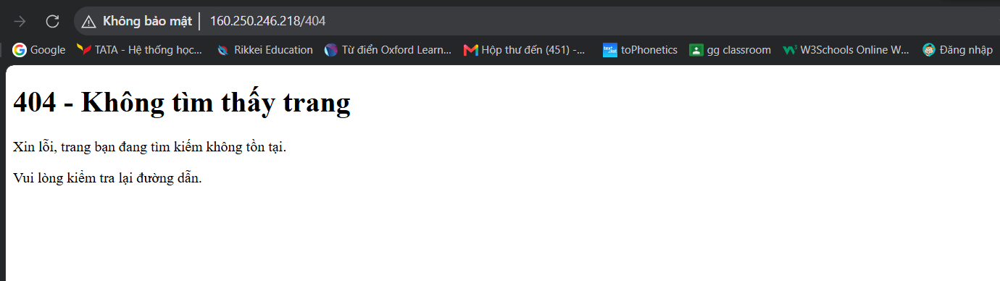

1. ảnh khi truy cập trang 404:

2. my-web — file Server Block Nginx đã chỉnh sửa:

server {
listen 80;
listen [::]:80;

    server_name _;

    root /var/www/my-web/html;
    index index.html;

    error_page 404 /404.html;

    location = /404.html {
        internal;
    }

    location / {
        try_files $uri $uri/ =404;
    }
}
